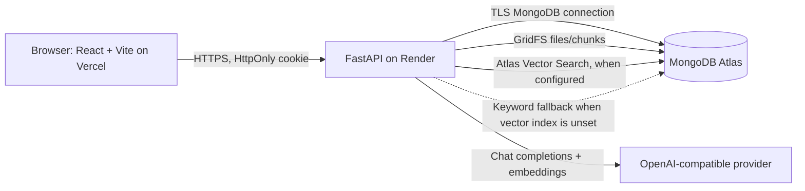

# NexusAI architecture and data design

## Deployment and runtime

In local development, the browser frontend is Vite at `localhost:5173`, the API is FastAPI at `localhost:8000`, and MongoDB may be local or Atlas. Production should use HTTPS and explicit frontend origins in `CORS_ORIGINS`. Prefer custom domains such as `support.example.com` and `api.example.com`: these are separate origins for CORS but same-site for browsers' cookie policy. Cross-site deployments on unrelated hostnames can have authentication cookies blocked by third-party-cookie restrictions.

## Backend boundaries

- FastAPI routers validate requests and enforce authenticated roles.
- `api/deps.py` resolves the HttpOnly-cookie JWT to an active user.
- Ticket routes scope tickets to customer ownership or agent assignment; internal messages are filtered from customer results.
- `api/knowledge.py` authorizes admin-only source management, validates and extracts uploads, and stores original bytes in MongoDB GridFS.
- `ai/knowledge.py` chunks extracted text, calls the configured embeddings API, and selects Atlas vector retrieval only when an index name is explicitly configured. An unset index uses labelled keyword matching; an unavailable configured index is an error.
- LLM output is structured and validated. Retrieved document text is untrusted data and cannot override system instructions. Unsupported RAG questions are answered as unknown and escalated to a human.

## Collections

| Collection | Purpose | Important indexes |
|---|---|---|
| `users` | Customer, agent, and admin accounts; password hashes | Unique `email` |
| `tickets` | Ticket state, ownership, assignment, classification | Unique `ticket_number`; `customer_id`, `assigned_agent_id`, `status`, `priority`, `created_at` |
| `ticket_messages` | Public conversation and staff-only notes | Compound `ticket_id`, `created_at` |
| `ticket_events` | Ticket audit history | Compound `ticket_id`, `created_at` |
| `counters` | Human-readable ticket sequence | `_id` |
| `ai_chat_sessions` | Per-customer bounded chat history | `_id` customer; TTL `expires_at` |
| `ai_rate_limits` | Fixed-window AI request counters | `_id`; TTL `expires_at` |
| `knowledge_documents` | Source metadata, status, tenant, uploader, GridFS id | Compound `tenant_id`, `created_at`; `tenant_id`, `status` |
| `knowledge_chunks` | Page-aware text chunks and embedding vectors | Compound `tenant_id`, `is_active`; `document_id`, `chunk_order`; optional Atlas Search vector index |
| `knowledge_sources.files` / `.chunks` | GridFS source documents and binary chunks | GridFS-managed indexes |

`KNOWLEDGE_TENANT_ID` scopes the knowledge-base service instance. The current user model does not include organization membership, so configuring multiple tenant IDs dynamically per account is not implemented. Run separate isolated deployments/databases for distinct businesses until organization-aware tenancy is added.

## Main workflows

### Ticket handling

Customer request -> authenticated ticket creation -> configured classifier (or visible pending classification) -> agent assignment -> public reply / staff-only note -> customer-visible conversation. AI suggestions are returned as drafts and are never sent without agent action.

### Knowledge-grounded response

Admin PDF/article -> validation and extraction -> bounded overlapping chunks with page metadata -> provider embeddings -> `knowledge_chunks` -> tenant/active scoped top-k retrieval -> grounded response generation -> response plus references to retrieved document names and pages. If retrieval is empty, the assistant states that it cannot find evidence and offers human support. References are assembled only from retrieved chunks.

## External service and storage boundaries

Uploaded source files are stored in GridFS, which stores the bytes in the configured MongoDB deployment rather than the Render instance filesystem. This survives application restarts and redeploys when MongoDB Atlas is the configured database. Atlas backups/retention must be configured separately. For high-volume large-file workloads, a private S3-compatible bucket with per-object access controls and server-side encryption is a future alternative.

All automated AI tests mock model and embedding methods. Real provider behavior and production Atlas vector index operation require deployment credentials and an operator-created vector index.
